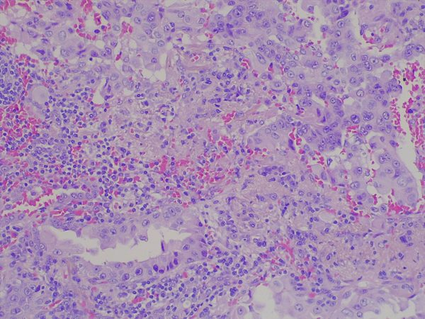
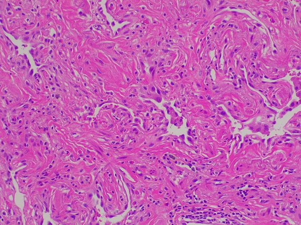
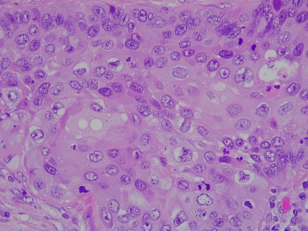
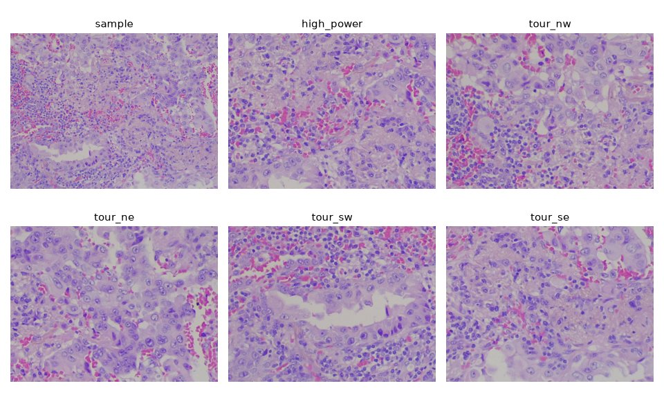
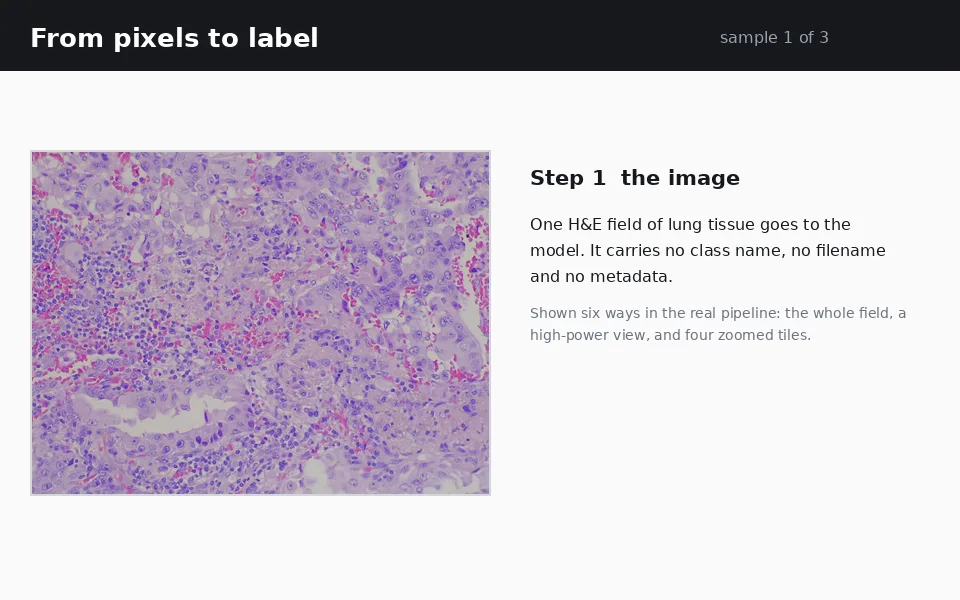
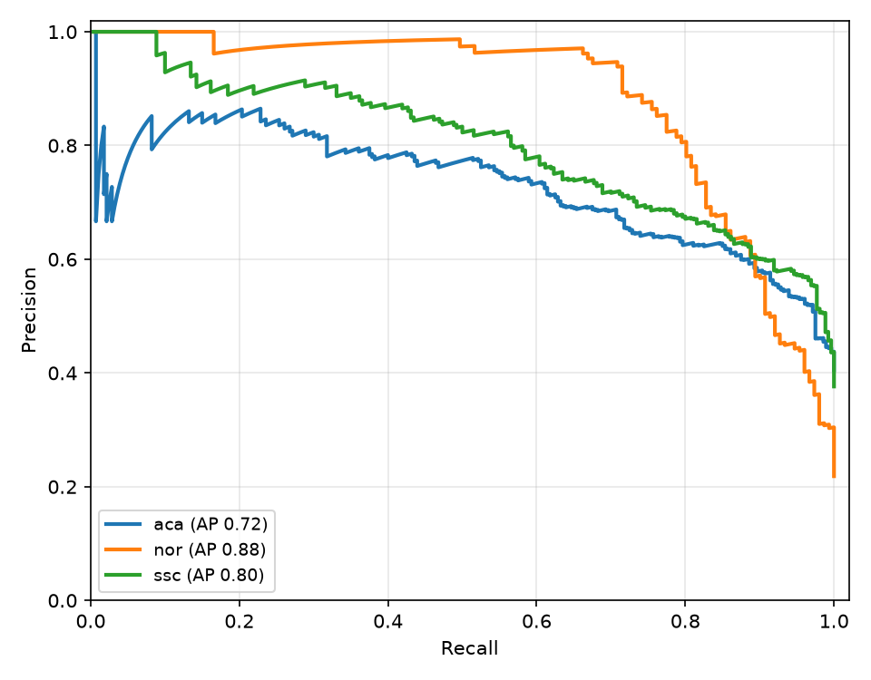
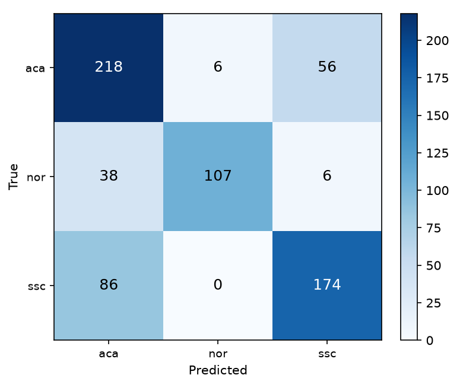

# Jev Lung Cancer Detection

A general vision model sorts lung tissue images into three classes by answering
clinical questions about them. It gets no training and no labels, only the
pixels and 55 questions like "does this field contain rings of cells around an
empty hole?" On LungHist700 it reaches **72.2% accuracy** on all 691 images.

## The problem

Pathologists classify lung tissue from patterns. Rings of cells around empty
holes point to adenocarcinoma. Sheets of angular cells with hard bright-pink
material point to squamous cell carcinoma. Open air sacs with thin walls point
to healthy lung. When the pattern is ambiguous they order stain tests (p40,
TTF-1); until then, morphology is all they have. This repo measures how far a
general vision model gets in that same situation: one H&E image in, one of
three classes out, zero training.

## The data

LungHist700 (Kaggle, `abdullahhasansajjad/lunghist700`) holds 691 JPEG fields
of lung tissue, 1600x1200 each:

| class | tissue | images | example |
|---|---|---:|---|
| `aca` | lung adenocarcinoma | 280 |  |
| `nor` | normal lung | 151 |  |
| `ssc` | lung squamous cell carcinoma | 260 |  |

The same tissue field sometimes appears twice, once at 20x and once at 40x
magnification. The download also ships a CSV with differentiation grade,
magnification and patient id; the code never reads it. The model receives
pixels only.
## How it works

Each image goes to Jev in one request, shown six ways: the whole field, a
high-power view of the same tissue (the real 40x field when the dataset has
one, otherwise a 2x zoom), and four zoomed tiles covering the field's corners.



Three predictions end to end, from pixels to label:



Along with the pixels, the model answers 55 questions: 45 yes/no observations
and 10 multiple-choice questions. Every question explains what to look for ("a
swirl of concentric bright pink layers wrapped around a centre, like the layers
of an onion"). Wording was chosen by A/B on the full dataset. Plain visual
words work better for the hard-pink features. Clinical terms like "gland lumen"
work better for the air-sac and gland patterns, so the shipped bank mixes both.
The full bank is in [`research/question_bank.md`](research/question_bank.md),
and the clinical background is in
[`research/lung_carcinoma_histopathology.md`](research/lung_carcinoma_histopathology.md).

The answers collapse into a class score through a two-stage decision with fixed
hand-written weights: first normal tissue vs carcinoma, then glandular vs
hard-pink growth. Nothing is fitted anywhere. Prompts never contain diagnosis
names, folder names or filenames; `protocol.assert_no_leaks` scans every
question for them before each request.

## Results

Graded once on all 691 images, after predictions were frozen. Full metrics in
[`reports/run.json`](reports/run.json).

Accuracy is 72.2% (95% CI 68.8-75.4, macro F1 0.74).

| class | precision | recall | F1 |
|---|---:|---:|---:|
| `aca` | 0.637 | 0.779 | 0.701 |
| `nor` | 0.947 | 0.709 | 0.811 |
| `ssc` | 0.737 | 0.669 | 0.702 |





Most errors sit on the boundary between the two cancers: 142 of 192 mistakes
are `aca` vs `ssc`. That boundary is the one pathologists resolve with stain
tests on real slides. Confidence tracks correctness, so the model can decline
to call hard cases. Holding back everything below 0.8 confidence leaves 22% of
the images at 92.1% accuracy, and above 0.9 the model has not been wrong yet.

## Reproduce

```sh
python3 -m venv .venv
.venv/bin/pip install -r requirements.txt
cp .env.sample .env            # add your TypeSafe key

.venv/bin/python scripts/00_download.py   # download LungHist700 via kagglehub
.venv/bin/python scripts/01_run.py        # classify the images
.venv/bin/python scripts/02_grade.py      # accuracy, per-class metrics, reports/run.json
.venv/bin/python scripts/03_report.py     # the figures in docs/
```

The published run cost $0.78 and took 57 seconds on 10 workers. Answers cache
under `runs/`, so reruns and re-grades are free. `01_run.py` takes `--fraction
0.2 --seed 7` for a stratified subset (1/5 of the data, equal class counts) and
`--count N` for the first N images of the index.

## Limits

The numbers are benchmark measurements. No output here is a diagnosis or
clinical advice.

- The dataset labels come from the authors and were not re-reviewed by a
  pathologist. Because 20x and 40x views of one field both appear, 691 images
  represent fewer independent specimens, so the confidence interval is
  optimistic.
- The two cancers are separated on morphology alone. On ambiguous fields,
  real practice uses p40 and TTF-1 stains, which an image of H&E cannot show.
- The normal class is healthy lung tissue. Benign mimics such as reactive
  atypia are not in the dataset.

## Data

LungHist700 (`abdullahhasansajjad/lunghist700` on Kaggle). Check the Kaggle
licence before redistributing pixels. This repository commits no dataset
images except the three examples above.
